<!-- Generated by scripts/build_svgs.py (refreshed daily by .github/workflows/refresh.yml). Edit the script, not this file. -->






  <a href="https://github.com/shayanscripts/watchword"></a>
  <a href="https://github.com/shayanscripts/GATE---General-Acceleration-Threshold-Examiner"></a>
  <a href="https://github.com/shayanscripts/selfguard"></a>
  <a href="https://github.com/shayanscripts/injection-holdout"></a>


  <a href="https://github.com/shayanscripts/redshift"></a>
  <a href="https://github.com/shayanscripts/noctilith"></a>


  <a href="https://github.com/shayanscripts/github-guard"></a>
  <a href="https://github.com/shayanscripts/repolens-ai"></a>


  <a href="https://github.com/shayanscripts/selfguard-v3"></a>



